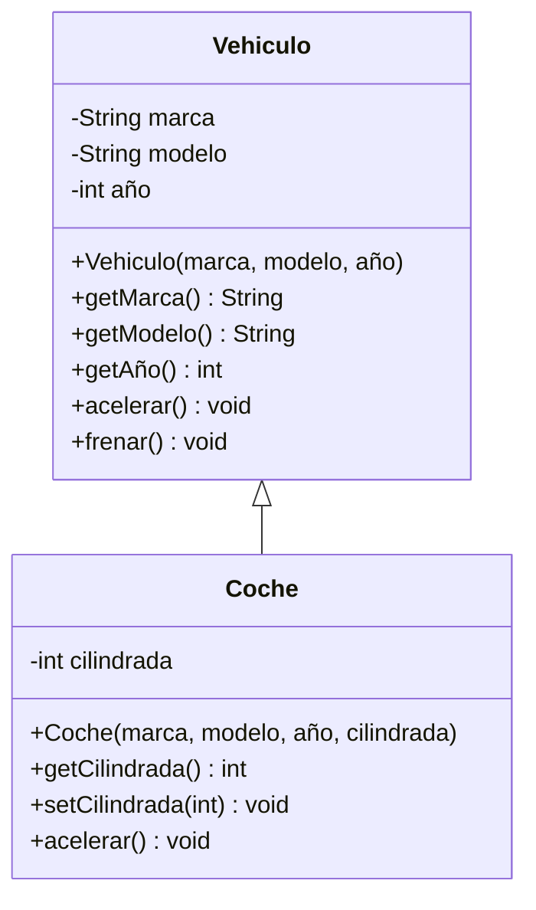

# DiplomaturaAutomationEjercicios

#Vehículos: Herencia y Encapsulamiento en Java

Programa en Java que modela el concepto de **vehículos** y **coches** aplicando dos pilares de la Programación Orientada a Objetos: **herencia** y **encapsulamiento**.

## Descripción

El proyecto define una clase base `Vehiculo` y una subclase `Coche` que hereda de ella y agrega su propia propiedad. En el método `main` se crean objetos de ambas clases, se muestran sus datos y se llama a `acelerar()` en cada uno para ver cómo responde según su clase.

## Conceptos aplicados

- **Encapsulamiento:** atributos privados con acceso mediante getters y setters.
- **Herencia:** `Coche` extiende de `Vehiculo` (`extends`) y reutiliza su constructor con `super`.
- **Sobrescritura de métodos:** `Coche` redefine `acelerar()` con `@Override`.
- **Polimorfismo:** cada objeto ejecuta la versión de `acelerar()` que corresponde a su clase.

## Estructura de clases



### `Vehiculo`

| Elemento | Detalle |
|----------|---------|
| Propiedades (privadas) | `marca` (String), `modelo` (String), `año` (int) |
| Constructor | Recibe marca, modelo y año |
| Getters | `getMarca()`, `getModelo()`, `getAño()` |
| Métodos | `acelerar()` y `frenar()`, que imprimen un mensaje con la acción |

### `Coche` (hereda de `Vehiculo`)

| Elemento | Detalle |
|----------|---------|
| Propiedad adicional (privada) | `cilindrada` (int) |
| Constructor | Recibe marca, modelo, año y cilindrada |
| Getter y setter | `getCilindrada()`, `setCilindrada(int)` |
| Método sobrescrito | `acelerar()` con mensaje propio del coche |

##Fragmento destacado

```java
public class Coche extends Vehiculo {
    private int cilindrada;

    public Coche(String marca, String modelo, int año, int cilindrada) {
        super(marca, modelo, año);
        this.cilindrada = cilindrada;
    }

    @Override
    public void acelerar() {
        System.out.println("El coche está acelerando");
    }
}
```

## Salida
```
Vehículo: Toyota Corolla (2020)
El vehículo está acelerando

Coche: Ford Mustang (2021) - 5000 cc
El coche está acelerando
```

## Qué aprendí

- Pensar qué características comparten los objetos y cuáles los diferencian antes de decidir qué va en la clase padre y qué en la hija.
- Proteger los datos de una clase con atributos privados y exponerlos de forma controlada.
- Cómo la sobrescritura permite que una subclase adapte el comportamiento heredado.

## Posibles mejoras

- Agregar más subclases (`Moto`, `Camión`).
- Convertir `Vehiculo` en una clase abstracta o definir una interfaz.
- Validar los datos en los constructores (por ejemplo, que el año sea válido).
- Agregar pruebas unitarias con JUnit.
